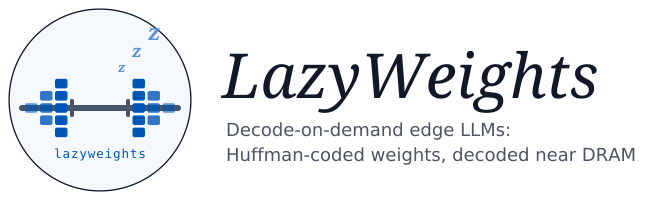
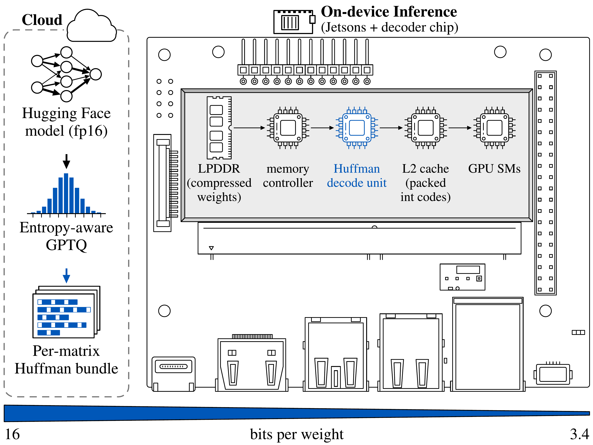
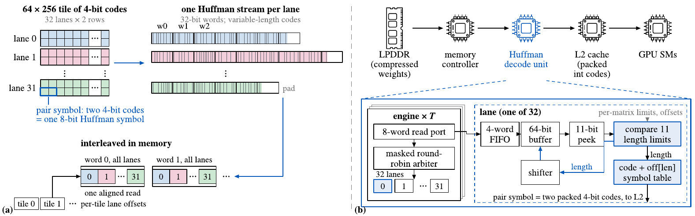
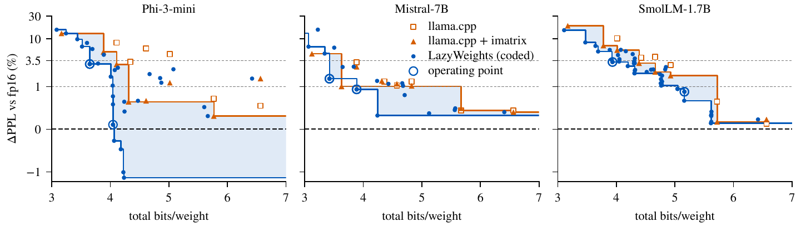
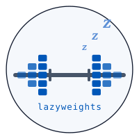

<p align="center">
  <picture>
    <source media="(prefers-color-scheme: dark)" srcset="assets/lazyweights-header-dark.svg">
    
  </picture>
</p>

<p align="center">
  <a href="https://arnabsanyal.com/preprint/lazyweights.html"></a>
  <a href="LICENSE"></a>
  
  
  
  
  
</p>

<p align="center">
  <a href="https://arnabsanyal.com/">Arnab Sanyal</a><sup>1</sup> &nbsp;·&nbsp; Gourav Datta<sup>2</sup> &nbsp;·&nbsp; Sandeep P. Chinchali<sup>1</sup><br>
  <sup>1</sup>The University of Texas at Austin &nbsp;·&nbsp; <sup>2</sup>Case Western Reserve University
</p>

> **TL;DR** The integer codes of a quantized LLM are far from uniform, yet every deployed format stores each one in
> the same number of bits. LazyWeights keeps llama.cpp's formats, tunes GPTQ so the codes compress, Huffman-codes them
> losslessly in interleaved lanes, and decodes them on demand in a small unit between DRAM and L2, so the GPU kernels
> run unchanged and DRAM moves only coded bytes. At equal perplexity budgets the models are 5.7–31.4% smaller than
> the best llama.cpp format.

## Abstract

Memory decides which LLMs an edge device runs, and how fast: capacity on a 4 GB Jetson Nano, bandwidth on an 8 GB
Jetson Orin Nano Super. Deployed formats (GPTQ, AWQ, llama.cpp's K- and I-quants) spend equal bits on every integer
code of a matrix, although the codes are far from uniform. LazyWeights keeps these formats but tunes GPTQ so the codes
compress, Huffman-codes them losslessly in interleaved lanes, and decodes them on demand in a small unit between DRAM
and L2, so GPU kernels run unchanged and DRAM moves only coded bytes. At 1% and 3.5% perplexity budgets, coded
Phi-3-mini, Mistral-7B and SmolLM-1.7B are 5.7–31.4% smaller than the best llama.cpp format. A bit-exact 0.21 mm²
ASIC decoder unit (1 GHz, 7 nm) cuts Orin latency and energy per token by up to 36% and 38% (54% and 44% with
prompt-lookup speculation). On the Nano, LazyWeights needs 58–64% less time and 53–57% less energy per token than CPU
llama.cpp, and runs a streamed Mistral-7B 6.6× faster at 3.89 bits per weight. A Huffman decoder beats an rANS decoder
in rate and area at equal throughput; the ASIC decoder unit runs bit-exact on a Zynq UltraScale+ FPGA (AMD ZCU102).

## How it works

<p align="center"></p>

- **Code selection.** `scripts/kq_quant.py` runs GPTQ into llama.cpp's own block formats (Q4_K, Q5_K, Q6_K,
  IQ4_XS), so the output is a valid GGUF that unmodified llama.cpp loads. Two knobs gear the grid to the coder:
  `--gamma` shares one step per super-block instead of one per sub-block, and `--coarse` widens it. The codes then
  concentrate where the weights do, and GPTQ's error feedback keeps the quality. `--lam` adds an entropy term to
  GPTQ's code choice.
- **Coding.** `scripts/kq_code.py` and `lazyweights/bundle.py` code every matrix with one length-limited Huffman
  table (11-bit codes). A 64 × 256 tile is 32 lanes of two rows each. The lanes' 32-bit words are interleaved, so one
  aligned read fetches the next word of every lane, and per-tile lane offsets let any tile start on its own. 4-bit
  codes are coded in pairs (one 8-bit symbol per two weights). Scales and minimums stay as llama.cpp stores them.
- **Decoding.** `hw/huff/rtl` holds the decode unit. *T* engines of 32 lanes share an 8-word read port through a
  masked round-robin arbiter. Each lane compares an 11-bit peek against per-length limits (no 2048-entry table),
  adds the length's offset to index the symbol table, and shifts its buffer by the length. `kernels/llmrt.cu` is
  the CUDA runtime that runs the coded models on the Jetsons, with software decode or the decode-free fixed-width
  twin as stand-ins for the unit.

<p align="center"></p>

## Results

Operating points on the Jetson Orin Nano Super (the paper's Table 1). b/w counts all overheads. ΔPPL is WikiText-2
against fp16. GSM8K is 8-shot chain of thought with flexible extraction. Saving is 1 − b<sub>ours</sub>/b<sub>llama.cpp</sub>.
Times and energies are per token with greedy decoding, LazyWeights with the decode unit.

| Model | Budget | Format | b/w | ΔPPL | HellaSwag | GSM8K | Saving | Orin ms / mJ |
|---|---|---|---:|---:|---:|---:|---:|---:|
| Phi-3-mini | ≤1% | llama.cpp IQ4_XS + imatrix | 4.311 | +0.65% | .783 | .785 | | 35.0 / 691 |
| | | **LazyWeights** | **4.046** | +0.11% | .778 | .773 | **6.2%** | **31.4 / 627** |
| | ≤3.5% | llama.cpp Q3_K_M + imatrix | 4.108 | +2.91% | .776 | .779 | | 44.0 / 840 |
| | | **LazyWeights** | **3.649** | +2.97% | .774 | .770 | **11.2%** | **31.4 / 616** |
| Mistral-7B | ≤1% | llama.cpp Q5_K_M | 5.668 | +0.44% | .842 | .425 | | 83.3 / 1784 |
| | | **LazyWeights** | **3.886** | +0.94% | .840 | .402 | **31.4%** | **53.0 / 1107** |
| | ≤3.5% | llama.cpp IQ3_M + imatrix | 3.628 | +1.01% | .838 | .400 | | 77.7 / 1611 |
| | | **LazyWeights** | **3.422** | +1.46% | .838 | .368 | **5.7%** | **52.9 / 1068** |
| SmolLM-1.7B | ≤1% | llama.cpp Q5_K_M | 5.721 | +0.65% | .607 | .064 | | 26.4 / 481 |
| | | **LazyWeights** | **5.162** | +0.88% | .607 | .067 | **9.8%** | **18.6 / 356** |
| | ≤3.5% | llama.cpp IQ4_XS + imatrix | 4.388 | +3.09% | .605 | .055 | | 23.7 / 375 |
| | | **LazyWeights** | **3.934** | +3.27% | .601 | .055 | **10.3%** | **15.3 / 287** |

<p align="center"></p>

Decoder blocks, logic synthesis (pre-layout), ASAP7 at 1 GHz: a comparator lane is 1,566 µm² (3.59 mW, +117 ps
slack); the 32-lane arbiter is 1,443 µm²; an engine (32 lanes + arbiter) is 0.0515 mm², and the Orin's 4-engine unit
is 0.206 mm². The same RTL runs bit-exact on a ZCU102 (4 engines at 100 MHz).

## Cite this work

```bibtex
@misc{sanyal2026lazyweights,
  title  = {LazyWeights: Decode-on-Demand Edge LLMs},
  author = {Sanyal, Arnab and Datta, Gourav and Chinchali, Sandeep P.},
  year   = {2026},
  note   = {Preprint, under review},
  url    = {https://arnabsanyal.com/preprint/lazyweights.html}
}
```

## Contact

Arnab Sanyal — [sanyal@utexas.edu](mailto:sanyal@utexas.edu) · [arnabsanyal.com](https://arnabsanyal.com/).
Bug reports and questions are welcome as GitHub issues.

## Installing dependencies

Tested on Linux with NVIDIA A100 80 GB GPUs, CUDA 13.0, Python 3.12 and PyTorch 2.11.

```bash
git clone https://github.com/arnabsanyal/lazyWeights.git
cd lazyWeights
python3.12 -m venv .venv && . .venv/bin/activate
pip install -r requirements.txt

# llama.cpp at the commit the paper used (its gguf-py, quantizer, imatrix and perplexity tools)
git clone https://github.com/ggml-org/llama.cpp third_party/llama.cpp
git -C third_party/llama.cpp checkout 5d7793d6fcce4eb4b11ab5be856dfa4e4c8fde9b
cmake -S third_party/llama.cpp -B third_party/llama.cpp/build -DGGML_CUDA=ON && cmake --build third_party/llama.cpp/build -j
```

### Paths

Everything defaults to folders inside the repository. Set these to put the large files elsewhere:

| Variable | Default | Contents |
|---|---|---|
| `LW_MODELS` | `./models` | per model: `hf_fp16/` (starting checkpoint), `gguf/` (llama.cpp files, ours in `gguf/kq/`), `rt_bundles/` |
| `LW_LLAMA_CPP` | `./third_party/llama.cpp` | llama.cpp checkout, built in `build/` |
| `ASIC_ENV` | (unset) | prefix of an environment with Yosys 0.38, OpenSTA, OpenROAD, Verilator 5 and Icarus Verilog (hardware flow) |
| `ORFS` | `~/work/OpenROAD-flow-scripts` | OpenROAD-flow-scripts checkout, for the ASAP7 and Nangate45 libraries |

## Reproducing the paper

**1. Starting weights.** Every quantizer, ours and llama.cpp's, starts from the fp16 weights of each model's
official ONNX release. `prepare_models.py` downloads that release, rebuilds the Hugging Face checkpoint from it and
checks the weights against the hash the paper's runs recorded. The official safetensors checkpoints differ from these
weights by up to 1 ulp, so the hash check fails if you start from them instead.

```bash
python scripts/prepare_models.py --model smollm      # also: phi3, mistral
```

**2. llama.cpp baselines.** These convert the checkpoint to an f16 GGUF (checked bit for bit against the
checkpoint), run each llama.cpp type with and without an importance matrix from our calibration set, and score every
file. The scores are WikiText-2 perplexity over the whole test set in 512-token chunks, plus lm-eval HellaSwag, ARC-e,
PIQA and GSM8K.

```bash
python scripts/a1_gguf.py --model smollm --types Q4_K_M,Q5_K_M,Q8_0,IQ4_XS,Q4_K_S,Q3_K_M,Q6_K
python scripts/a1_gguf.py --model smollm --imatrix --types IQ3_XXS,IQ3_M,Q3_K_M,IQ4_XS,Q4_K_S,Q4_K_M,Q5_K_M,Q6_K
python scripts/kq_code.py --model smollm --types Q4_K_S,Q4_K_M,IQ4_XS,Q5_K_M,Q6_K   # llama.cpp's own codes, Huffman-coded
```

**3. Our points.** Entropy-aware GPTQ into a llama.cpp format, written as GGUF, scored the same way and sized both
packed and Huffman-coded. These are the six operating points of the table above:

```bash
python scripts/kq_quant.py --model phi3    --recipe IQ4_XS --gamma 0 --coarse 1.25   # <=1%
python scripts/kq_quant.py --model phi3    --recipe IQ4_XS --gamma 1 --coarse 1.25   # <=3.5%
python scripts/kq_quant.py --model mistral --recipe IQ4_XS --gamma 1                 # <=1%
python scripts/kq_quant.py --model mistral --recipe IQ4_XS --gamma 1 --coarse 1.5    # <=3.5%
python scripts/kq_quant.py --model smollm  --recipe Q5_K_M --gamma 1                 # <=1%
python scripts/kq_quant.py --model smollm  --recipe IQ4_XS --gamma 1                 # <=3.5%
python scripts/kq_tables.py          # budget tables + headline task accuracy -> results/kq_tables.md
python scripts/figs/fig_frontier.py  # Fig. 4 -> figs/fig_frontier.pdf
```

Rows are appended to `results/a1_frontier.jsonl`; the file in the repository holds the paper's rows. GPTQ on the GPU
is deterministic here: rerunning the SmolLM ≤3.5% point from a fresh checkout writes a GGUF byte-identical to the
paper's.

**4. Runtime bundles and the Jetsons.** `a2_kq_bundle.py` turns a GGUF into a runtime bundle (coded matrices plus the
format's side bytes; `--packed` also writes the fixed-width twin). It checks every matrix: the Huffman decode, and the
dequantization from (codes, side bytes) against gguf-py's, bit for bit. Build the runtime on the device and run it
with the drivers in `scripts/device/` (they record power with `tegrastats`):

```bash
python scripts/a2_kq_bundle.py --model smollm --gguf IQ4_XS_g1_lam0.gguf --packed
nvcc -O3 -std=c++17 -arch=sm_87 --default-stream per-thread -DPHI3RT_MAIN kernels/llmrt.cu -o llmrt -lpthread   # Orin, JetPack 6
nvcc -O3 -std=c++14 -arch=sm_53 -DPHI3RT_MAIN kernels/llmrt.cu -o llmrt -lpthread                               # Nano, CUDA 10.2
./llmrt <bundle> graph-check | fwd-bench | decode-bench | spec      # see ./llmrt for options
```

`a2_spec_energy.py`, `a5_system.py`, `a5_energy.py` and `a5_variance.py` turn the device runs into per-token time
and energy, with the decode unit modelled at the measured fixed-width-twin time. `scripts/figs/fig_gain.py` reads
the raw device logs (to be released, see TODO). `scripts/figs/fig_strip.py` draws Fig. 5 from the derived
`results/a5_gain.jsonl`.

**5. Decoder hardware.** Each step checks against the one before it: C model, RTL co-simulation, synthesis, FPGA.

```bash
python scripts/a4_csim.py      # C++ engine model (hw/huff/huff_engine.h) == NumPy decoder, on the bundles
python scripts/a4_cosim.py     # Verilator co-simulation of hw/huff/rtl, cycle-exact against the C model
hw/huff/syn/synth.sh huff_lane lane_cmp "BUF 64 FIFO 4 LOOKUP 1"        # Yosys + OpenSTA, ASAP7 RVT TT, 1 GHz
hw/huff/syn/synth.sh huff_lane lane_tab "BUF 64 FIFO 4 LOOKUP 0"        # the 2048-entry table lane, for comparison
ABC_D=350 REPAIR=1 hw/huff/syn/synth.sh huff_arb arb8_d350 "LANES 32 PORT 8"
PLATFORM=nangate45 CLK_PS=2000 hw/huff/syn/synth.sh huff_lane ng45_lane_cmp "BUF 64 FIFO 4 LOOKUP 1"
hw/huff/syn/power.sh lane_cmp <stim.hex from a4_cosim> <tag>   # gate-level power with co-simulation activity
python scripts/a4_report.py    # collects build/syn/ into results/a4_asic.jsonl and results/a4_report.md
python scripts/a4_pairs.py     # pair symbols on/off;  a4_rans_rate.py: rANS vs Huffman rate;  a4_sys.py: system check
vivado -mode batch -source hw/huff/fpga/build_zcu.tcl -tclargs 4 4 12 f100   # ZCU102; host side: zcu_jobs.py, zcu_host.py
```

### Repository layout

| Folder | Role |
|---|---|
| `lazyweights/` | shared Python: model specs (`models.py`), GPTQ and calibration (`quant.py`), tasks (`evaltasks.py`), Huffman / rANS codecs, the bundle format (`bundle.py`), result logging |
| `scripts/` | the pipeline above, one script per step; `figs/` draws Figs. 4 and 5; `device/` holds the Jetson drivers as run |
| `kernels/` | `llmrt.cu`, the CUDA runtime (fused decode + GEMV, CUDA graphs, prompt-lookup speculation, streaming); `membw_energy.cu`, the DRAM-energy benchmark |
| `hw/huff/` | decode unit: RTL (`rtl/`), C++ model and testbenches (`huff_engine.h`, `tb/`), synthesis and power (`syn/`), OpenROAD flow (`orfs/`), Nexys / ZCU102 FPGA builds (`fpga/`) |
| `hw/rans/` | the rANS engine used for comparison |
| `results/` | the rows behind every table and figure (JSONL, with Markdown summaries) |
| `assets/` | logo (generated by `assets/src/gen_logo.py`) and README figures |

## Model artifacts

LazyWeights quantizes public checkpoints:
[Phi-3-mini-4k-instruct](https://huggingface.co/microsoft/Phi-3-mini-4k-instruct-onnx),
[Mistral-7B-Instruct-v0.2](https://huggingface.co/microsoft/mistral-7b-instruct-v0.2-ONNX) and
[SmolLM-1.7B-Instruct](https://huggingface.co/HuggingFaceTB/SmolLM-1.7B-Instruct), each from its fp16 ONNX release.
Two kinds of file are worth downloading: the six operating-point GGUFs, which run in unmodified llama.cpp, and their
coded runtime bundles. Links will be added here when they are released.

## TODO

- [ ] Release the six operating-point GGUFs and their coded bundles
- [ ] Release the raw Jetson logs (tegrastats and runtime output) behind `fig_gain.py` and the energy tables
- [ ] Add the arXiv link and citation

## References

- **llama.cpp** — [github.com/ggml-org/llama.cpp](https://github.com/ggml-org/llama.cpp) (GGUF formats, K- and I-quants, importance matrix)
- **GPTQ**: Frantar et al., ICLR 2023 — [github.com/IST-DASLab/gptq](https://github.com/IST-DASLab/gptq)
- **AWQ**: Lin et al., MLSys 2024 — [github.com/mit-han-lab/llm-awq](https://github.com/mit-han-lab/llm-awq)
- **lm-evaluation-harness** — [github.com/EleutherAI/lm-evaluation-harness](https://github.com/EleutherAI/lm-evaluation-harness)
- **ASAP7 PDK** and **OpenROAD-flow-scripts** — [github.com/The-OpenROAD-Project/OpenROAD-flow-scripts](https://github.com/The-OpenROAD-Project/OpenROAD-flow-scripts)

## License

[MIT](LICENSE).

-----

<p align="center">
  <picture>
    <source media="(prefers-color-scheme: dark)" srcset="assets/lazyweights-mark-dark.svg">
    
  </picture>
</p>
