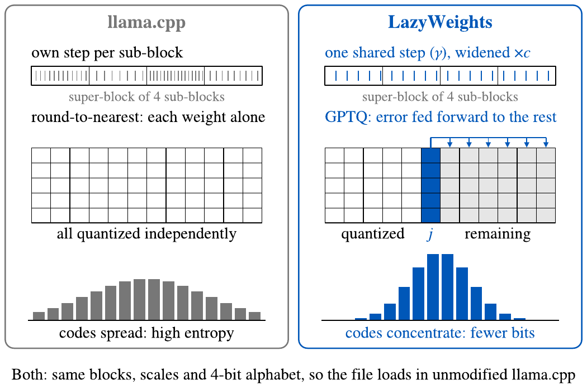
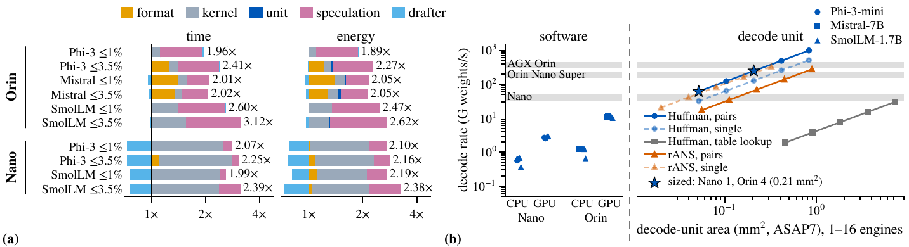

<p align="center">
  <picture>
    <source media="(prefers-color-scheme: dark)" srcset="assets/lazyweights-header-dark.svg">
    
  </picture>
</p>

<p align="center">
  <a href="https://arnabsanyal.com/preprint/lazyweights.html"></a>
  <a href="LICENSE"></a>
  
  
  
  
  <a href="https://github.com/arnabsanyal/lazyWeights/releases"></a>
  <a href="https://huggingface.co/collections/arnabsanyal/lazyweights-6af7242c458566ddfc0b34de"></a>
  <a href="https://arxiv.org/abs/2611.17108"></a>
</p>

<p align="center">
  <a href="https://arnabsanyal.com/">Arnab Sanyal</a><sup>1</sup> &nbsp;·&nbsp; Gourav Datta<sup>2</sup> &nbsp;·&nbsp; Sandeep P. Chinchali<sup>1</sup><br>
  <sup>1</sup>The University of Texas at Austin &nbsp;·&nbsp; <sup>2</sup>Case Western Reserve University
</p>

> **TL;DR** The integer codes of a quantized LLM are far from uniform, yet every deployed format stores each one in
> the same number of bits. LazyWeights keeps llama.cpp's formats, tunes GPTQ so the codes compress, Huffman-codes them
> losslessly in interleaved lanes, and decodes them on demand in a small unit between DRAM and L2, so the GPU kernels
> run unchanged and DRAM moves only coded bytes. At equal perplexity budgets the models are 5.7–31.4% smaller than
> the best llama.cpp format.

## Abstract

Memory decides which LLMs an edge device runs, and how fast: capacity on a 4 GB Jetson Nano, bandwidth on an 8 GB
Jetson Orin Nano Super. Deployed formats (GPTQ, AWQ, llama.cpp's K- and I-quants) spend equal bits on every integer
code of a matrix, although the codes are far from uniform. LazyWeights keeps these formats but tunes GPTQ so the codes
compress, Huffman-codes them losslessly in interleaved lanes, and decodes them on demand in a small unit between DRAM
and L2, so GPU kernels run unchanged and DRAM moves only coded bytes. At 1% and 3.5% perplexity budgets, coded
Phi-3-mini, Mistral-7B and SmolLM-1.7B are 5.7–31.4% smaller than the best llama.cpp format. A bit-exact 0.21 mm²
ASIC decoder unit (1 GHz, 7 nm) cuts Orin latency and energy per token by up to 36% and 38% (54% and 44% with
prompt-lookup speculation). On the Nano, LazyWeights needs 58–64% less time and 53–57% less energy per token than CPU
llama.cpp, and runs a streamed Mistral-7B 6.6× faster at 3.89 bits per weight. A Huffman decoder beats an rANS decoder
in rate and area at equal throughput; the ASIC decoder unit runs bit-exact on a Zynq UltraScale+ FPGA (AMD ZCU102).

## How it works

<p align="center"></p>

- **Code selection.** `scripts/kq_quant.py` runs GPTQ into llama.cpp's own block formats (Q4_K, Q5_K, Q6_K,
  IQ4_XS), so the output is a valid GGUF that unmodified llama.cpp loads. Two knobs gear the grid to the coder:
  `--gamma` shares one step per super-block instead of one per sub-block, and `--coarse` widens it. The codes then
  concentrate where the weights do, and GPTQ's error feedback keeps the quality. `--lam` adds an entropy term to
  GPTQ's code choice.

<p align="center"></p>

- **Coding.** `scripts/kq_code.py` and `lazyweights/bundle.py` code every matrix with one length-limited Huffman
  table (11-bit codes). A 64 × 256 tile is 32 lanes of two rows each. The lanes' 32-bit words are interleaved, so one
  aligned read fetches the next word of every lane, and per-tile lane offsets let any tile start on its own. 4-bit
  codes are coded in pairs (one 8-bit symbol per two weights). Scales and minimums stay as llama.cpp stores them.
- **Decoding.** `hw/huff/rtl` holds the decode unit. *T* engines of 32 lanes share an 8-word read port through a
  masked round-robin arbiter. Each lane compares an 11-bit peek against per-length limits (no 2048-entry table),
  adds the length's offset to index the symbol table, and shifts its buffer by the length. `kernels/llmrt.cu` is
  the CUDA runtime that runs the coded models on the Jetsons, with software decode or the decode-free fixed-width
  twin as stand-ins for the unit.

<p align="center"></p>

## Results

Tables and figures are numbered as in the paper.

### Platforms (Table I)

The two Jetsons are bound by different things, so compression buys different things on each. The ZCU102 runs the
decode unit itself, to check it bit for bit and cycle for cycle against the C model. DRAM use is weight bytes per token
divided by time per token, as a fraction of bandwidth, for our fixed-width kernels.

| | Jetson Orin Nano Super | Jetson Nano | AMD ZCU102 (FPGA) |
|---|---|---|---|
| Role | edge GPU, runs the models | edge GPU, runs the models | decode-unit prototype |
| Memory / bandwidth | 8 GB, 102 GB/s | 4 GB, 22.5 GB/s (meas.) | 4 GB PS DDR4; payload in on-chip BRAM (464 BRAM36) |
| Compute | Ampere GPU, 1024 cores | Maxwell GPU, 128 cores | Zynq UltraScale+ ZU9EG: 4 engines × 32 lanes at 112.5 MHz, 4× Cortex-A53 host |
| int8 `dp4a` / toolchain | yes / CUDA 12.6 | no / CUDA 10.2 | – / Vivado 2025.2 |
| Utilization | DRAM use, packed: 40–64% | DRAM use, packed: 34–35% | 183.0k LUTs (67%), 37.2k FFs, 464 BRAM36 (51%), 0 DSPs |
| Mistral-7B | fits | does not fit (streamed) | – (29 matrices, 484M weights decoded) |
| **Bound by** | **memory bandwidth** | **instructions + capacity** | **the engine's decode → arbiter loop (~115 MHz)** |
| **Compression buys** | latency, energy | ability to run; the unit buys latency, energy | – ; shows the decode is bit- and cycle-exact: 14.3 G weights/s, 0.26 nJ per weight |

### Operating points on the Orin Nano Super (Table III)

The upper row of each pair is the llama.cpp budget baseline in its own format. b/w counts all overheads. ΔPPL is
WikiText-2 against fp16. GSM8K is 8-shot chain of thought with flexible extraction. Saving is
1 − b<sub>ours</sub>/b<sub>llama.cpp</sub>.

Times and energies are ms / mJ per token, and each runtime uses its own drafter. LazyWeights is run with the decode
unit, at the measured twin time. Δt is shown as bandwidth-bound / conservative. ΔE assumes a clock-gated decoder.

| Model | Budget | Format | b/w | ΔPPL | HellaSwag | ARC-e | PIQA | GSM8K | Saving | Greedy ms / mJ | Δt | ΔE | Speculation ms / mJ | Δt | ΔE |
|---|---|---|---:|---:|---:|---:|---:|---:|---:|---:|---:|---:|---:|---:|---:|
| Phi-3-mini | ≤1% | IQ4_XS + imatrix | 4.311 | +0.65% | .783 | .807 | .798 | .785 | | 35.0 / 691 | | | 27.4 / 495 | | |
| | | **LazyWeights** | **4.046** | +0.11% | .778 | .803 | .789 | .773 | **6.2%** | **31.4 / 627** | −15/−10% | −9% | **17.9 / 366** | −39/−35% | −26% |
| | ≤3.5% | Q3_K_M + imatrix | 4.108 | +2.91% | .776 | .786 | .799 | .779 | | 44.0 / 840 | | | 27.6 / 512 | | |
| | | **LazyWeights** | **3.649** | +2.97% | .774 | .811 | .796 | .770 | **11.2%** | **31.4 / 616** | −37/−29% | −27% | **18.3 / 370** | −42/−34% | −28% |
| Mistral-7B | ≤1% | Q5_K_M | 5.668 | +0.44% | .842 | .716 | .768 | .425 | | 83.3 / 1784 | | | 61.6 / 1276 | | |
| | | **LazyWeights** | **3.886** | +0.94% | .840 | .720 | .770 | .402 | **31.4%** | **53.0 / 1107** | −41/−36% | −38% | **41.5 / 871** | −37/−33% | −32% |
| | ≤3.5% | IQ3_M + imatrix | 3.628 | +1.01% | .838 | .722 | .779 | .400 | | 77.7 / 1611 | | | 71.6 / 1397 | | |
| | | **LazyWeights** | **3.422** | +1.46% | .838 | .719 | .782 | .368 | **5.7%** | **52.9 / 1068** | −44/−32% | −34% | **38.5 / 786** | −56/−46% | −44% |
| SmolLM-1.7B | ≤1% | Q5_K_M | 5.721 | +0.65% | .607 | .633 | .737 | .064 | | 26.4 / 481 | | | 14.3 / 246 | | |
| | | **LazyWeights** | **5.162** | +0.88% | .607 | .630 | .739 | .067 | **9.8%** | **18.6 / 356** | −33/−29% | −26% | **10.1 / 194** | −33/−29% | −21% |
| | ≤3.5% | IQ4_XS + imatrix | 4.388 | +3.09% | .605 | .625 | .732 | .055 | | 23.7 / 375 | | | 16.5 / 254 | | |
| | | **LazyWeights** | **3.934** | +3.27% | .601 | .610 | .736 | .055 | **10.3%** | **15.3 / 287** | −40/−36% | −23% | **7.6 / 143** | −57/−54% | −44% |

<p align="center"></p>

**Fig. 4.** Rate–quality frontiers. Dots are coded models, including llama.cpp's imatrix codes behind our Huffman
stage. Lines show the lowest ΔPPL reachable at or below a rate, and shading marks where coding wins. Rings are the
released operating points; dashed lines are the 1% and 3.5% budgets and fp16.

<p align="center"></p>

**Fig. 5.** (a) Factors from the llama.cpp baseline (greedy) to LazyWeights with the unit and our drafter. Each step
makes one change and is drawn on a log scale; the top half is the Orin and the bottom half the Nano. (b) Decode rate.
The left panel shows software decoders; the right panel shows ASAP7 area against rate for 1–16 engines, with Huffman
compared to rANS. Bands show the rate each device's DRAM delivers.

### The Jetson Nano (Table IV)

Values are per token: ms / J, except Mistral, which is s / J. CPU is llama.cpp with the budget baseline or our GGUF.
GPU is our runtime, decoding in software or with the unit (twin time). Mistral streams from USB 3 at a 2560 MB
resident budget, and its twin is no proxy for the unit.

| Mode | Model | Budget | CPU, baseline | CPU, LazyWeights GGUF | GPU, software | GPU, + unit |
|---|---|---|---:|---:|---:|---:|
| Greedy | Phi-3 | ≤1% | 657 / 4.48 | 654 / 4.40 | 591 / 4.24 | **261 / 2.05** |
| | | ≤3.5% | 736 / 4.80 | 663 / 4.45 | 590 / 4.46 | **263 / 2.08** |
| | SmolLM | ≤1% | 366 / 2.47 | 364 / 2.21 | 484 / 3.22 | **152 / 1.17** |
| | | ≤3.5% | 317 / 2.12 | 317 / 2.03 | 289 / 2.10 | **134 / 0.97** |
| | Mistral | ≤1% | 22.6 / 71.2 | 18.0 / 58.3 | **3.40 / 15.8** | n/a |
| | | ≤3.5% | **1.93** / 12.7 | 15.1 / 49.0 | 2.08 / **12.0** | n/a |
| Prompt-lookup speculation | Phi-3 | ≤1% | 840 / 5.60 | 865 / 5.74 | 423 / 2.94 | **244 / 1.71** |
| | | ≤3.5% | 956 / 6.23 | 864 / 5.74 | 415 / 3.05 | **239 / 1.69** |
| | SmolLM | ≤1% | 475 / 3.10 | 437 / 2.66 | 286 / 1.84 | **141 / 0.91** |
| | | ≤3.5% | 419 / 2.73 | 469 / 2.94 | 170 / 1.17 | **101 / 0.65** |
| | Mistral | ≤1% | 16.7 / 56.6 | 13.3 / 46.1 | **2.30 / 11.3** | n/a |
| | | ≤3.5% | 2.90 / 19.1 | 11.5 / 40.2 | **1.49 / 8.85** | n/a |

### Runtime optimizations (Table II)

Each row shows a measurement before → after the change.

| Change | Measured on | Effect |
|---|---|---|
| Speculative attention, GGUF-width twins | SmolLM 8-token pass, depth 400 | 44.4 → 31.2 ms |
| | Phi-3 8-token pass, depth 900 | 77.5 → 52.5 ms |
| Nano kernels | SmolLM ≤1% twin, greedy token | 474 → 152 ms |
| | SmolLM ≤3.5% | 282 → 134 ms |
| | Phi-3 | 585 → 261 ms |
| Ordered reduction | Nano, 2-token coded pass | 418 → 301 ms |
| CUDA graphs | Orin pass (485–645 kernels) | −1.9 to −3.5 ms (7–12%) |
| | per greedy token | −6 to −11% |

### Decoder hardware (Table V) and the FPGA prototype

These are logic-synthesis results (pre-layout), with ASAP7 RVT TT at 1 GHz and Nangate45 at 500 MHz.

| Block | ASAP7 µm² | ASAP7 mW | ASAP7 slack | Nangate45 µm² | Nangate45 mW | Nangate45 slack |
|---|---:|---:|---:|---:|---:|---:|
| Comparator lane | **1,566** | **3.59** | +117 ps | 23,462 | 25.2 | +0.5 ns |
| Table lane (2048 entries) | 14,076 | 94.4 | −31 ns | – | – | – |
| Arbiter, 32 lanes | **1,443** | **0.83** | met† | 18,639 | 4.25 | +1.5 ns |
| Arbiter, 64 lanes | 9,174 | – | −0.29 ns | – | – | – |
| Engine | **51,550** | **115.7** | – | – | – | – |

† after OpenROAD repair. Power for the comparator lane uses co-simulation activity; the other blocks use default
activity. Bold: Engine = 32 comparator lanes + the 32-lane arbiter. The Orin's 4-engine unit is 0.206 mm², and the
Nano needs one engine.

Huffman beats rANS on both rate and area. rANS is never smaller (0.0 to +1.0% more bits), and at equal throughput
(2 G weights/s) it needs 4.0× the area with pair symbols, or 1.15× with single codes.

On the ZCU102, four engines close timing at 112.5 MHz (WNS +0.06 ns). All 29 matrices (2,723 chunks, 484M weights)
decode bit-exact, with cycle, stall and word counts equal to the C model on every chunk. That is 31.8 weights per cycle
per engine, 14.3 G weights/s in all. The fabric draws 0.88 W idle plus 3.7 W at full rate, which is 0.26 nJ per weight
(`results/a4_zcu.md`).

### Ablations (Table VI)

Each cell is b/w, ΔPPL (%) at the operating-point settings. γ = 0 uses llama.cpp's own per-sub-block fit. RTN replaces
GPTQ with round-to-nearest at the same grid.

| Model | Budget | Full | γ = 0 | RTN |
|---|---|---|---|---|
| Phi-3 | ≤3.5% | 3.649, +2.97 | 4.046, +0.11 | 3.646, +12.07 |
| Mistral | ≤1% | 3.886, +0.94 | 4.241, +0.32 | 3.886, −0.04 |
| | ≤3.5% | 3.422, +1.46 | 3.837, +2.61 | 3.422, +2.78 |
| SmolLM | ≤1% | 5.162, +0.88 | 5.621, +0.31 | 5.162, +0.57 |
| | ≤3.5% | 3.934, +3.27 | 4.321, +2.24 | 3.934, +6.14 |

## Cite this work

```bibtex
@misc{sanyal2026lazyweightsdecodeondemandedgellms,
  title         = {{LazyWeights: Decode-on-Demand Edge LLMs}},
  author        = {Sanyal, Arnab and Datta, Gourav and Chinchali, Sandeep P.},
  year          = {2026},
  eprint        = {2611.17108},
  archivePrefix = {arXiv},
  primaryClass  = {cs.LG},
  url           = {https://arxiv.org/abs/2611.17108}
}
```

## Contact

Arnab Sanyal — [sanyal@utexas.edu](mailto:sanyal@utexas.edu) · [arnabsanyal.com](https://arnabsanyal.com/).
Bug reports and questions are welcome as GitHub issues.

## Installing dependencies

Tested on Linux with NVIDIA A100 80 GB GPUs, CUDA 13.0, Python 3.12 and PyTorch 2.11.

```bash
git clone https://github.com/arnabsanyal/lazyWeights.git
cd lazyWeights
python3.12 -m venv .venv && . .venv/bin/activate
pip install -r requirements.txt

# llama.cpp at the commit the paper used (its gguf-py, quantizer, imatrix and perplexity tools)
git clone https://github.com/ggml-org/llama.cpp third_party/llama.cpp
git -C third_party/llama.cpp checkout 5d7793d6fcce4eb4b11ab5be856dfa4e4c8fde9b
cmake -S third_party/llama.cpp -B third_party/llama.cpp/build -DGGML_CUDA=ON && cmake --build third_party/llama.cpp/build -j
```

### Paths

Everything defaults to folders inside the repository. Set these to put the large files elsewhere:

| Variable | Default | Contents |
|---|---|---|
| `LW_MODELS` | `./models` | per model: `hf_fp16/` (starting checkpoint), `gguf/` (llama.cpp files, ours in `gguf/kq/`), `rt_bundles/` |
| `LW_LLAMA_CPP` | `./third_party/llama.cpp` | llama.cpp checkout, built in `build/` |
| `ASIC_ENV` | (unset) | prefix of an environment with Yosys 0.38, OpenSTA, OpenROAD, Verilator 5 and Icarus Verilog (hardware flow) |
| `ORFS` | `~/work/OpenROAD-flow-scripts` | OpenROAD-flow-scripts checkout, for the ASAP7 and Nangate45 libraries |

## Reproducing the paper

**1. Starting weights.** Every quantizer, ours and llama.cpp's, starts from the fp16 weights of each model's
official ONNX release. `prepare_models.py` downloads that release, rebuilds the Hugging Face checkpoint from it and
checks the weights against the hash the paper's runs recorded. The official safetensors checkpoints differ from these
weights by up to 1 ulp, so the hash check fails if you start from them instead.

```bash
python scripts/prepare_models.py --model smollm      # also: phi3, mistral
```

**2. llama.cpp baselines.** These convert the checkpoint to an f16 GGUF (checked bit for bit against the
checkpoint), run each llama.cpp type with and without an importance matrix from our calibration set, and score every
file. The scores are WikiText-2 perplexity over the whole test set in 512-token chunks, plus lm-eval HellaSwag, ARC-e,
PIQA and GSM8K.

```bash
python scripts/a1_gguf.py --model smollm --types Q4_K_M,Q5_K_M,Q8_0,IQ4_XS,Q4_K_S,Q3_K_M,Q6_K
python scripts/a1_gguf.py --model smollm --imatrix --types IQ3_XXS,IQ3_M,Q3_K_M,IQ4_XS,Q4_K_S,Q4_K_M,Q5_K_M,Q6_K
python scripts/kq_code.py --model smollm --types Q4_K_S,Q4_K_M,IQ4_XS,Q5_K_M,Q6_K   # llama.cpp's own codes, Huffman-coded
```

**3. Our points.** Entropy-aware GPTQ into a llama.cpp format, written as GGUF, scored the same way and sized both
packed and Huffman-coded. These are the six operating points of the table above:

```bash
python scripts/kq_quant.py --model phi3    --recipe IQ4_XS --gamma 0 --coarse 1.25   # <=1%
python scripts/kq_quant.py --model phi3    --recipe IQ4_XS --gamma 1 --coarse 1.25   # <=3.5%
python scripts/kq_quant.py --model mistral --recipe IQ4_XS --gamma 1                 # <=1%
python scripts/kq_quant.py --model mistral --recipe IQ4_XS --gamma 1 --coarse 1.5    # <=3.5%
python scripts/kq_quant.py --model smollm  --recipe Q5_K_M --gamma 1                 # <=1%
python scripts/kq_quant.py --model smollm  --recipe IQ4_XS --gamma 1                 # <=3.5%
python scripts/kq_tables.py          # budget tables + headline task accuracy -> results/kq_tables.md
python scripts/figs/fig_frontier.py  # Fig. 4 -> figs/fig_frontier.pdf
```

Rows are appended to `results/a1_frontier.jsonl`; the file in the repository holds the paper's rows. GPTQ on the GPU
is deterministic here: rerunning the SmolLM ≤3.5% point from a fresh checkout writes a GGUF byte-identical to the
paper's.

**4. Runtime bundles and the Jetsons.** `a2_kq_bundle.py` turns a GGUF into a runtime bundle (coded matrices plus the
format's side bytes; `--packed` also writes the fixed-width twin). It checks every matrix: the Huffman decode, and the
dequantization from (codes, side bytes) against gguf-py's, bit for bit. Build the runtime on the device and run it
with the drivers in `scripts/device/` (they record power with `tegrastats`):

```bash
python scripts/a2_kq_bundle.py --model smollm --gguf IQ4_XS_g1_lam0.gguf --packed
nvcc -O3 -std=c++17 -arch=sm_87 --default-stream per-thread -DPHI3RT_MAIN kernels/llmrt.cu -o llmrt -lpthread   # Orin, JetPack 6
nvcc -O3 -std=c++14 -arch=sm_53 -DPHI3RT_MAIN kernels/llmrt.cu -o llmrt -lpthread                               # Nano, CUDA 10.2
./llmrt <bundle> graph-check | fwd-bench | decode-bench | spec      # see ./llmrt for options
```

`a2_spec_energy.py`, `a5_system.py`, `a5_energy.py` and `a5_variance.py` turn the device runs into per-token time
and energy, with the decode unit modelled at the measured fixed-width-twin time. The raw device runs (runtime output and
`tegrastats` power, 15.5 MB) are a release asset; unpack them over the repository to rerun these scripts and
`scripts/figs/fig_gain.py`:

```bash
curl -L https://github.com/arnabsanyal/lazyWeights/releases/download/v1.0/lazyweights-device-logs.tar.gz | tar xz
python scripts/a5_energy.py; python scripts/a5_variance.py results/a2_orin/var; python scripts/figs/fig_gain.py
```

`scripts/figs/fig_strip.py` draws Fig. 5 (shown under Results) from the derived
`results/a5_gain.jsonl`.

**5. Decoder hardware.** Each step checks against the one before it: C model, RTL co-simulation, synthesis, FPGA.

```bash
python scripts/a4_csim.py      # C++ engine model (hw/huff/huff_engine.h) == NumPy decoder, on the bundles
python scripts/a4_cosim.py     # Verilator co-simulation of hw/huff/rtl, cycle-exact against the C model
hw/huff/syn/synth.sh huff_lane lane_cmp "BUF 64 FIFO 4 LOOKUP 1"        # Yosys + OpenSTA, ASAP7 RVT TT, 1 GHz
hw/huff/syn/synth.sh huff_lane lane_tab "BUF 64 FIFO 4 LOOKUP 0"        # the 2048-entry table lane, for comparison
ABC_D=350 REPAIR=1 hw/huff/syn/synth.sh huff_arb arb8_d350 "LANES 32 PORT 8"
PLATFORM=nangate45 CLK_PS=2000 hw/huff/syn/synth.sh huff_lane ng45_lane_cmp "BUF 64 FIFO 4 LOOKUP 1"
hw/huff/syn/power.sh lane_cmp <stim.hex from a4_cosim> <tag>   # gate-level power with co-simulation activity
python scripts/a4_report.py    # collects build/syn/ into results/a4_asic.jsonl and results/a4_report.md
python scripts/a4_pairs.py     # pair symbols on/off;  a4_rans_rate.py: rANS vs Huffman rate;  a4_sys.py: system check
vivado -mode batch -source hw/huff/fpga/build_zcu.tcl -tclargs 4 3.75 10 f112r   # ZCU102, 112.5 MHz; host side: zcu_jobs.py, zcu_host.py
```

### Repository layout

| Folder | Role |
|---|---|
| `lazyweights/` | shared Python: model specs (`models.py`), GPTQ and calibration (`quant.py`), tasks (`evaltasks.py`), Huffman / rANS codecs, the bundle format (`bundle.py`), result logging |
| `scripts/` | the pipeline above, one script per step; `figs/` draws Figs. 4 and 5; `device/` holds the Jetson drivers as run |
| `kernels/` | `llmrt.cu`, the CUDA runtime (fused decode + GEMV, CUDA graphs, prompt-lookup speculation, streaming); `membw_energy.cu`, the DRAM-energy benchmark |
| `hw/huff/` | decode unit: RTL (`rtl/`), C++ model and testbenches (`huff_engine.h`, `tb/`), synthesis and power (`syn/`), OpenROAD flow (`orfs/`), Nexys / ZCU102 FPGA builds (`fpga/`) |
| `hw/rans/` | the rANS engine used for comparison |
| `results/` | the rows behind every table and figure (JSONL, with Markdown summaries) |
| `assets/` | logo (generated by `assets/src/gen_logo.py`) and README figures (Figs. 1–5 of the paper, as PNG) |

## Model artifacts

LazyWeights quantizes public checkpoints:
[Phi-3-mini-4k-instruct](https://huggingface.co/microsoft/Phi-3-mini-4k-instruct-onnx),
[Mistral-7B-Instruct-v0.2](https://huggingface.co/microsoft/mistral-7b-instruct-v0.2-ONNX) and
[SmolLM-1.7B-Instruct](https://huggingface.co/HuggingFaceTB/SmolLM-1.7B-Instruct), each from its fp16 ONNX release.
The six operating points are on Hugging Face, one repository per model, gathered in the
[LazyWeights collection](https://huggingface.co/collections/arnabsanyal/lazyweights-6af7242c458566ddfc0b34de):

| Model | Repository | Points (≤1% / ≤3.5%) |
|---|---|---|
| Phi-3-mini-4k-instruct | [arnabsanyal/LazyWeights-Phi-3-mini-4k-instruct](https://huggingface.co/arnabsanyal/LazyWeights-Phi-3-mini-4k-instruct) | `IQ4_XS_g0_lam0_c1.25` / `IQ4_XS_g1_lam0_c1.25` |
| Mistral-7B-Instruct-v0.2 | [arnabsanyal/LazyWeights-Mistral-7B-Instruct-v0.2](https://huggingface.co/arnabsanyal/LazyWeights-Mistral-7B-Instruct-v0.2) | `IQ4_XS_g1_lam0` / `IQ4_XS_g1_lam0_c1.5` |
| SmolLM-1.7B-Instruct | [arnabsanyal/LazyWeights-SmolLM-1.7B-Instruct](https://huggingface.co/arnabsanyal/LazyWeights-SmolLM-1.7B-Instruct) | `Q5_K_M_g1_lam0` / `IQ4_XS_g1_lam0` |

Each point comes in two forms. The GGUF (`gguf/kq/`) runs in unmodified llama.cpp. Its coded runtime bundle
(`rt_bundles/`) runs in `kernels/llmrt.cu`. The tensors in the GGUFs are byte-identical to the files the paper measured,
and `SHA256SUMS` lists each repository's files.

A repository holds one model folder of `$LW_MODELS`:

```bash
hf download arnabsanyal/LazyWeights-SmolLM-1.7B-Instruct          --local-dir $LW_MODELS/smollm-1-7b-instruct
hf download arnabsanyal/LazyWeights-Phi-3-mini-4k-instruct         --local-dir $LW_MODELS/phi3-mini-4k-instruct
hf download arnabsanyal/LazyWeights-Mistral-7B-Instruct-v0.2       --local-dir $LW_MODELS/mistral-7b-instruct-v0.2
```

The fixed-width twins (`--packed`) and the Nano streaming layouts are not uploaded. Rebuild them from the GGUF with
`scripts/a2_kq_bundle.py`.

## TODO

- [x] Release the six operating-point GGUFs and their coded bundles ([Hugging Face collection](https://huggingface.co/collections/arnabsanyal/lazyweights-6af7242c458566ddfc0b34de))
- [x] Release the raw Jetson logs (tegrastats and runtime output) behind `fig_gain.py` and the energy tables
- [x] Add the arXiv link and citation

## References

- **llama.cpp** — [github.com/ggml-org/llama.cpp](https://github.com/ggml-org/llama.cpp) (GGUF formats, K- and I-quants, importance matrix)
- **GPTQ**: Frantar et al., ICLR 2023 — [github.com/IST-DASLab/gptq](https://github.com/IST-DASLab/gptq)
- **AWQ**: Lin et al., MLSys 2024 — [github.com/mit-han-lab/llm-awq](https://github.com/mit-han-lab/llm-awq)
- **lm-evaluation-harness** — [github.com/EleutherAI/lm-evaluation-harness](https://github.com/EleutherAI/lm-evaluation-harness)
- **ASAP7 PDK** and **OpenROAD-flow-scripts** — [github.com/The-OpenROAD-Project/OpenROAD-flow-scripts](https://github.com/The-OpenROAD-Project/OpenROAD-flow-scripts)

## License

[MIT](LICENSE).

-----

<p align="center">
  <picture>
    <source media="(prefers-color-scheme: dark)" srcset="assets/lazyweights-mark-dark.svg">
    
  </picture>
</p>
